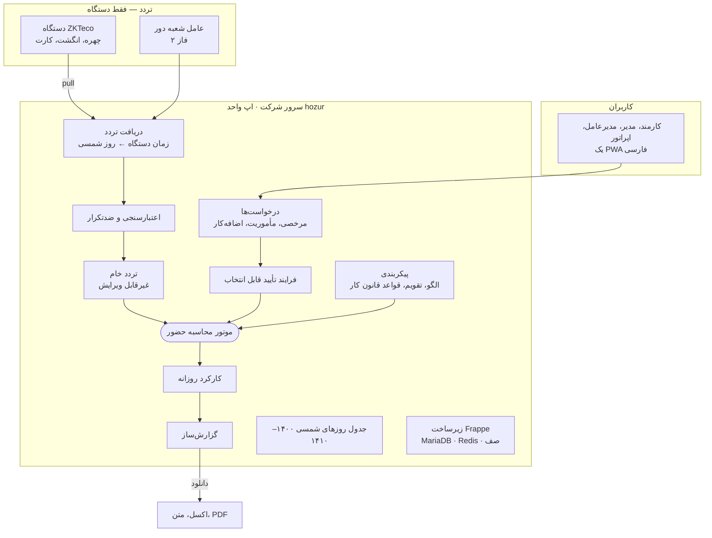
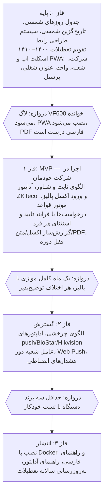

# سند طراحی نرم‌افزار حضور و غیاب (روی Frappe)

۱۴ مهر ۱۴۰۵ · آراد

## خلاصه و دامنه

یک اپ واحد و متن‌باز روی Frappe می‌سازیم که روی سرور هر شرکت نصب می‌شود، تردد را فقط از دستگاه می‌گیرد و ساعت کار، اضافه‌کار، مرخصی و مأموریت را طبق قانون کار حساب می‌کند. کارکنان و مدیران از یک PWA فارسی استفاده می‌کنند و خروجی نهایی گزارش‌هایی است که اپراتور خودش می‌سازد.

| داخل دامنه | خارج از دامنه |
| --- | --- |
| تقویم شمسی تا ۱۴۱۰ و تعطیلات رسمی قابل‌ویرایش | محاسبه حقوق، بیمه و مالیات |
| واحد، عنوان شغلی، الگوی کاری و انتساب به افراد | ثبت تردد از پرتال یا گوشی (فقط دستگاه) |
| دریافت تردد از دستگاه‌های چهره، اثر انگشت و کارت | ربات بله یا هر پیام‌رسان دیگر |
| درخواست مرخصی، مأموریت، اضافه‌کار و اصلاح تردد با فرایند تأیید قابل انتخاب | اپلیکیشن بومی اندروید یا iOS |
| PWA یکپارچه برای کارمند، مدیر، مدیرعامل و اپراتور | سرویس ابری چندشرکتی |
| گزارش‌ساز با خروجی اکسل، متن و PDF | تأیید کارکرد ماهانه توسط کارمند |

مبنای قواعد، فایل «قوانین و قواعد کاری لازم برای طراحی نرم‌افزار حضور و غیاب» (به‌روز تا مهر ۱۴۰۵) در فولدر پروژه است.

## تصمیم‌های پایه

همه‌چیز داخل یک اپ Frappe است (نام کاری: hozur): تقویم شمسی، حضور، مرخصی، گردش تأیید، گزارش‌ساز و PWA. خود Frappe را فورک نمی‌کنیم و Frappe HR را نصب نمی‌کنیم؛ از ساختار Frappe استفاده می‌کنیم و برای شیفت، حضور و مرخصی از کد Frappe HR الگو می‌گیریم.

**چرا قبلاً دو اپ بود و حالا یکی است؟** تقویم شمسی تنها بخشی است که هر کاربر ایرانی Frappe (مثلاً ERPNext) به آن نیاز دارد؛ اپ جدا یعنی دیگران بدون نصب حضور و غیاب از آن استفاده کنند. برای هدف این پروژه این مزیت کم است و یک اپ نصب، نسخه‌دهی و توسعه را ساده‌تر می‌کند. تقویم شمسی هم ماژول جدا نیست؛ در هسته اپ ساخته می‌شود و همه تاریخ‌های کاری شمسی ذخیره می‌شوند.

| لایه | فناوری | دلیل |
| --- | --- | --- |
| بک‌اند | Python + Frappe Framework v16 | فرم، API، دسترسی، صف و زمان‌بند آماده |
| فرانت‌اند | Vue 3 + TypeScript + frappe-ui + Tailwind | همان روش Frappe HR و Helpdesk؛ برای رابط زیبا و موبایل‌محور |
| ظاهر | فونت وزیرمتن، RTL از پایه، حالت تیره | فارسی درجه‌یک، نه ترجمه‌شده |
| دیتابیس | MariaDB + Redis | پیش‌فرض Frappe |
| PDF | WeasyPrint | پشتیبانی درست از فارسی و RTL؛ در فاز ۰ تست می‌شود |
| استقرار | Docker Compose روی سرور شرکت | نصب و به‌روزرسانی با یک دستور |

تصمیم‌های مشخص:

1. **یک اپ، یک رابط:** همه نقش‌ها (کارمند، مدیر، مدیرعامل، اپراتور) از همان PWA کار می‌کنند. پنل Desk خود Frappe رایگان هست و فقط برای مدیر سیستم و تنظیمات کم‌کاربرد باز می‌ماند؛ از بقیه پنهان است.
2. **تاریخ:** تاریخ‌های کاری (روز کارکرد، مرخصی، تعطیلی، انتساب، دوره) شمسی ذخیره می‌شوند و گزارش، فیلتر و خروجی مستقیم روی همین مقدارها کار می‌کنند. فقط دو جا میلادی می‌ماند: زمان خامی که دستگاه می‌فرستد، و ستون‌های داخلی creation و modified خود Frappe که بدون فورک قابل حذف نیستند و هیچ‌جا نمایش داده نمی‌شوند.
3. **قانون به‌صورت داده با کف قانونی:** پارامترها در «مجموعه قواعد» با تاریخ اجرا نگهداری می‌شوند. مدیر سیستم نمی‌تواند مقداری بدتر از حد قانون برای کارگر تنظیم کند؛ فقط سخاوتمندانه‌تر.
4. **استقرار روی سرور هر شرکت:** یک سایت Frappe برای هر شرکت؛ چندمستأجری لازم نیست.
5. **لایسنس GPLv3**، چون از کد Frappe HR برداشت می‌کنیم.
6. **آماده برای وایب‌کد:** موتور قواعد پایتون خالص با تست خودکار برای هر ماده قانون، ساختار پوشه ثابت، و یک فایل راهنما در ریشه مخزن که قواعد کدنویسی را برای هوش مصنوعی توضیح می‌دهد.

## فیچرهای کلی

هشت ماژول داریم؛ نسخه اول (MVP) باید بتواند یک ماه کامل کارکرد شرکت خودمان را از دستگاه ZKTeco تا گزارش نهایی ببندد.

| ماژول | فیچرها | اولویت |
| --- | --- | --- |
| تقویم شمسی | تاریخ‌گزین شمسی، تقویم ۱۴۰۰ تا ۱۴۱۰، تعطیلات رسمی و موردی، ورود تعطیلی جدید توسط اپراتور | MVP |
| ساختار سازمانی | شعبه، واحد درختی (مبلمان، کافه، اکسسوری)، عنوان شغلی، پرونده پرسنل، مدیر مستقیم | MVP |
| الگوی کاری | ثابت، شناور، چرخشی (نوبت‌کاری)، انتساب به فرد/واحد/عنوان شغلی با تاریخ اعتبار | MVP (چرخشی: فاز ۲) |
| تردد و دستگاه | خواندن مستقیم ZKTeco از سرور، ورود فایل، نگاشت شناسه، سلامت دستگاه | MVP (برندهای دیگر: فاز ۲) |
| موتور محاسبه | تأخیر، تعجیل، غیبت، اضافه‌کار، شب‌کاری، نوبت‌کاری، جمعه‌کاری، تعطیل‌کاری، هشدارهای قانونی | MVP |
| درخواست و تأیید | مرخصی روزانه/ساعتی، مأموریت، اضافه‌کار، اصلاح تردد؛ فرایند تأیید قابل انتخاب (بدون تأیید، یک یا دو مرحله) با استثنا برای هر فرد | MVP |
| گزارش‌ساز | انتخاب ستون، فیلتر و گروه‌بندی، ذخیره قالب، خروجی اکسل، متن و PDF | MVP |
| امنیت و سابقه | تاریخچه تغییرناپذیر هر اصلاح، قفل دوره ماهانه، رضایت‌نامه بیومتریک، دسترسی نقش‌محور | MVP |

قفل دوره یعنی بعد از بستن ماه توسط اپراتور، هیچ تردد یا مرخصی‌ای در آن ماه بدون بازکردن رسمی عوض نمی‌شود. تأیید کارکرد توسط کارمند حذف شد؛ اعتبار سوابق در اختلاف از تاریخچه تغییرناپذیر می‌آید.

## تقویم شمسی و تعطیلات

تاریخ شمسی مبنای کل اپ است؛ هیچ تاریخ کاری‌ای میلادی ذخیره نمی‌شود. همه روزهای ۱۴۰۰ تا ۱۴۱۰ (حدود ۴۰۰۰ روز) در یک جدول «روز تقویم» از قبل ساخته می‌شوند و موتور به‌جای تبدیل تاریخ، از همین جدول می‌خواند. سال ۱۴۰۵ با ۲۵ روز تعطیل رسمی از فایل قوانین وارد می‌شود؛ تعطیلات قمری سال‌های بعد «پیش‌بینی» هستند و اپراتور آن‌ها را قطعی می‌کند.

**شکل ذخیره و کار با تاریخ شمسی:**

- هر تاریخ کاری رشته شمسی با صفر ابتدایی است (مثل 1405/07/14 در دیتابیس، ۱۴۰۵/۰۷/۱۴ در نمایش)؛ همین شکل درست مرتب می‌شود و فیلتر بازه‌ای بدون تبدیل کار می‌کند
- سال و ماه شمسی هم فیلد جدا دارند، پس گزارش «مهر ۱۴۰۵» یک فیلتر ساده است
- روز هفته، نوع روز (کاری، جمعه، تعطیل رسمی) و روز بعد/قبل از جدول روز تقویم خوانده می‌شود
- تاریخ‌گزین و تقویم ماهانه PWA از ابتدا شمسی ساخته می‌شوند، نه تبدیل تاریخ‌گزین میلادی
- برای سال‌های بعد از ۱۴۱۰، اپراتور با یک دکمه روزهای سال جدید را می‌سازد

**تنها مرز میلادی، دستگاه است.** پروتکل ZKTeco زمان هر تردد را با تقویم میلادی و سال شمارش‌شده از ۲۰۰۰ می‌فرستد؛ حتی اگر فریم‌ور فارسی روی صفحه دستگاه شمسی نشان دهد. هنگام دریافت، زمان خام دست‌نخورده به‌عنوان سند نگه داشته می‌شود و همان لحظه روز شمسی و ساعت کنارش ثبت می‌شود؛ از آنجا به بعد هیچ بخشی با میلادی کار نمی‌کند.

**منبع تقویم و نیاز به به‌روزرسانی:** خود تقویم شمسی هیچ‌وقت به‌روزرسانی نمی‌خواهد؛ فقط تعطیلات قمری سالانه تأیید می‌خواهند.

| بخش | به‌روزرسانی | منبع |
| --- | --- | --- |
| روزهای ماه، کبیسه، روز هفته | هرگز؛ الگوریتم Borkowski تا حدود سال ۱۶۳۴ دقیق است | [jalaali-js](https://github.com/jalaali/jalaali-js) در رابط، jdatetime در پایتون |
| ۱۰ تعطیل رسمی شمسی | هرگز؛ تاریخ ثابت دارند | داخل اپ |
| حدود ۱۶ تعطیل قمری | سالانه؛ طول ماه قمری در ایران با رؤیت هلال و اعلام رسمی تعیین می‌شود | فایل آزاد [persian-calendar/events](https://github.com/persian-calendar/events) (CC0) و جدول رسمی ماه‌های قمری |
| تعطیلی موردی دولت | هر بار که اعلام شود | ورود اپراتور |

حتی پرکاربردترین تقویم متن‌باز ایرانی ([persian-calendar](https://github.com/persian-calendar/calendar)) تاریخ قمری رسمی ایران را فقط تا سال ۱۴۰۵ دارد. پس اپ برای سال‌های بعد تعطیلات قمری را تخمینی می‌سازد و «پیش‌بینی» علامت می‌زند، دکمه «به‌روزرسانی تقویم» فایل تأییدشده تازه را از مخزن پروژه می‌گیرد، و از اسفند هر سال اگر تعطیلات سال بعد هنوز پیش‌بینی باشند به اپراتور هشدار می‌دهد.

**انواع روز تعطیل:**

| نوع | مثال | منبع داده | شامل کارگران؟ |
| --- | --- | --- | --- |
| رسمی شمسی | نوروز، ۲۲ بهمن | پیش‌بارگذاری تا ۱۴۱۰ | بله، با مزد (ماده ۶۳) |
| رسمی قمری | عاشورا، عید فطر | پیش‌بینی، تأیید سالانه اپراتور | بله، با مزد |
| رسمی موردی (سراسری یا استانی) | تعطیلی اعلامی هیئت دولت در تیر ۱۴۰۵ | ورود اپراتور با استان | بله؛ وزارت کار این را ذیل ماده ۶۳ ابلاغ کرد |
| تعطیلی موردی ادارات | آلودگی هوا، گرما | ورود اپراتور | به تشخیص اپراتور: تعطیل با مزد، تصمیم کارفرما با مزد، یا روز کاری |
| تعطیل هفتگی | جمعه، یا روز دیگر برای کافه (ماده ۶۲) | الگوی کاری هر نفر | بله |
| داخلی شرکت | تعطیلی بین دو تعطیل | ورود اپراتور | فقط همان شرکت، با مزد |

تعطیلی پنجشنبه یا شنبه فعلاً فقط برای کارکنان دولت است؛ برای کارگران در الگوی کاری قابل تنظیم می‌ماند. هر روز تعطیل تاریخ، عنوان، نوع، وضعیت (پیش‌بینی/قطعی)، دامنه (کشوری/استان/شعبه) و دلیل تغییر دارد. اگر اپراتور تعطیلی ماهی را که محاسبه شده عوض کند، کارکرد آن روز خودکار دوباره حساب می‌شود (مگر دوره قفل باشد).

## ساختار سازمانی و الگوی کاری

الگوی کاری را می‌شود به فرد، عنوان شغلی، واحد یا کل شرکت نسبت داد؛ همه انتساب‌ها تاریخ شروع و پایان دارند تا سابقه حفظ شود.

**موجودیت‌ها:**

- **شرکت و شعبه:** هر شعبه استان دارد (برای تعطیلی‌های استانی) و دستگاه‌های خودش. مبلمان، کافه و اکسسوری یک کد بیمه دارند، پس با واحد از هم جدا می‌شوند و کارگاه جدا لازم نیست.
- **واحد سازمانی:** درختی (واحد ← زیرواحد)، هر واحد یک مدیر و یک تأییدکننده پیش‌فرض دارد.
- **عنوان شغلی:** با پرچم «کار سخت و زیان‌آور» که سقف ۶ و ۳۶ ساعت، ممنوعیت اضافه‌کار و مرخصی ۵ هفته‌ای را فعال می‌کند؛ فقط وقتی روشن می‌شود که کمیته مشاغل سخت رأی داده باشد.
- **پرسنل:** کد پرسنلی، کد ملی، تاریخ شروع و پایان همکاری، نوع قرارداد (تمام‌وقت، پاره‌وقت، ساعتی)، واحد، عنوان شغلی، مدیر مستقیم، شناسه‌های دستگاه، تاریخ تولد (برای قواعد کارگر نوجوان، با دسترسی محدود).

**الگوی کاری سه نوع دارد:**

| نوع | تعریف | مثال |
| --- | --- | --- |
| ثابت | برای هر روز هفته ساعت شروع، پایان و استراحت | شنبه تا چهارشنبه ۸ تا ۱۶، پنجشنبه ۸ تا ۱۲ |
| شناور | بازه ورود مجاز + حداقل ساعت روزانه | ورود ۷ تا ۹، ۸ ساعت کار |
| چرخشی (نوبتی) | دنباله‌ای از شیفت‌ها با طول چرخه و روز شروع | ۲ صبح، ۲ عصر، ۲ شب، ۲ استراحت (سقف ۱۷۶ ساعت در ۴ هفته) |

هر الگو این تنظیمات را هم دارد: تأخیر و تعجیل مجاز (دقیقه)، شیفت شب‌گذر (مثل ۲۲ تا ۶)، از چه زمانی اضافه‌کار حساب شود، و روز تعطیل هفتگی. موقع ذخیره، سیستم ساعت هفتگی الگو را با سقف قانونی مقایسه می‌کند و هشدار می‌دهد.

**اولویت انتساب** (اولین موردی که برای آن تاریخ وجود داشته باشد برنده است):

1. تغییر موردی همان روز (جابه‌جایی شیفت)
2. انتساب مستقیم به فرد
3. انتساب به عنوان شغلی
4. انتساب به واحد (و اگر نبود، واحد بالادست)
5. الگوی پیش‌فرض شرکت

## ثبت تردد و اتصال به دستگاه‌ها

تردد فقط از دستگاه می‌آید. چون سرور داخل شبکه شرکت است، خود اپ هر چند دقیقه مستقیماً لاگ دستگاه ZKTeco را می‌خواند و برنامه واسطه لازم نیست؛ عامل همگام‌سازی فقط برای شعبه‌های دور استفاده می‌شود. همه دستگاه‌ها از طریق یک «آداپتور» وصل می‌شوند و خروجی همه‌شان یک شکل است: «تردد خام».

**کنار نرم‌افزار پالیز:** دستگاه فعلی (احتمالاً ZKTeco VF600) به پالیز وصل است. خواندن لاگ از شبکه (پورت ۴۳۷۰) مزاحم پالیز نیست، پس برای ماه آزمایشی هر دو نرم‌افزار همزمان کار می‌کنند. پالیز لاگ دستگاه را پاک نمی‌کند و اپ ما هم هرگز پاک نمی‌کند. سابقه قدیمی با فایل اکسل خروجی پالیز وارد می‌شود؛ قالب ورود از روی یک نمونه واقعی ساخته می‌شود.

| روش اتصال | نحوه کار | نمونه | فاز |
| --- | --- | --- | --- |
| Pull از سرور | کار پس‌زمینه هر چند دقیقه لاگ دستگاه را می‌خواند | ZKTeco با کتابخانه pyzk | MVP |
| ورود فایل | فایل USB، اکسل یا خروجی پالیز با قالب قابل‌تنظیم | هر دستگاه بدون شبکه، سابقه قدیمی | MVP |
| Push به سرور | دستگاه خودش تردد را به یک آدرس HTTP می‌فرستد | ZKTeco ADMS، Hikvision ISAPI | ۲ |
| API نرم‌افزار سازنده | خواندن از سرور مرکزی سازنده | Suprema BioStar 2 | ۲ |
| عامل شعبه دور | برنامه کوچک پایتونی که در شعبه لاگ را می‌خواند، صف می‌کند و با API امن می‌فرستد | شعبه در شهر دیگر | ۲ |

**تعریف دستگاه بدون کدنویسی:** اپراتور در صفحه «دستگاه‌ها» دکمه «دستگاه جدید» را می‌زند و این فیلدها را پر می‌کند:

- نام و شعبه
- نوع اتصال از فهرست (ZKTeco، Hikvision، Suprema، ورود فایل)
- IP، پورت (پیش‌فرض ZKTeco عدد ۴۳۷۰) و رمز ارتباطی دستگاه
- فاصله خواندن (مثلاً هر ۵ دقیقه)
- جهت تردد: از خود دستگاه، یا ثابت «ورود» یا «خروج» برای دستگاه‌های جدای در ورودی

کنار فرم چهار دکمه هست: «تست اتصال» (مدل، شماره سریال و تعداد کاربر و لاگ را نشان می‌دهد)، «خواندن کاربران دستگاه» برای نگاشت شناسه‌ها به پرسنل، «تنظیم ساعت دستگاه» و «خواندن دوباره از تاریخ». برای دستگاه‌های Push اپ آدرسی را نشان می‌دهد که باید در منوی دستگاه وارد شود. برای ورود فایل، اپراتور یک بار مشخص می‌کند کدام ستون شناسه، تاریخ و ساعت است و قالب ذخیره می‌شود.

عوض‌کردن IP، اضافه‌کردن دستگاه دوم یا دستگاهی از برندی که همین پروتکل را دارد (مثل eSSL که پروتکل ZKTeco دارد) هیچ تغییری در کد نمی‌خواهد. فقط برندی با پروتکل کاملاً تازه یک بار آداپتور می‌خواهد؛ بعد از آن در فهرست نوع اتصال ظاهر می‌شود و برای همه شرکت‌ها کار می‌کند. تا آن موقع همان دستگاه از مسیر ورود فایل قابل استفاده است.

**هر تردد خام:** دستگاه، شناسه کاربر در دستگاه، زمان، جهت (ورود/خروج/نامشخص)، روش احراز و داده اصلی. فقط اضافه می‌شود، هیچ‌وقت ویرایش یا حذف نمی‌شود.

- **تکراری:** دو تردد یک نفر با فاصله کمتر از چند ثانیه یکی حساب می‌شود؛ واردکردن دوباره یک فایل چیزی را دو برابر نمی‌کند.
- **تردد بی‌صاحب:** شناسه نگاشت‌نشده در صف «ترددهای ناشناس» می‌ماند.
- **ساعت:** منطقه زمانی Asia/Tehran؛ اختلاف ساعت دستگاه با سرور هشدار می‌دهد و اپراتور می‌تواند ساعت دستگاه را تنظیم کند.
- **حریم خصوصی:** الگوی چهره و اثر انگشت روی دستگاه می‌ماند؛ اپ فقط شناسه و زمان را نگه می‌دارد. طبق مواد ۵۸ و ۵۹ قانون تجارت الکترونیکی، رضایت‌نامه بیومتریک هر نفر با تاریخ در پرونده‌اش ثبت می‌شود و کارت به‌عنوان روش جایگزین باقی می‌ماند.

## قواعد قانون کار

موتور برای هر نفر و هر روز ساعت‌ها را دسته‌بندی می‌کند و مبلغ ریالی حساب نمی‌کند. جدول زیر با فایل قوانین پروژه تطبیق داده شده است. ستون «نوع» می‌گوید مدیر سیستم چقدر اختیار دارد: «ثابت» یعنی فقط به نفع کارگر قابل تغییر است.

| موضوع | قاعده | ماده | نوع |
| --- | --- | --- | --- |
| ساعت کار | حداکثر ۸ ساعت در روز، ۴۴ ساعت در هفته؛ توزیع نابرابر در هفته با توافق. ناهار، نماز و استراحت جزو آن نیست | ۵۱ و تبصره ۱ | سقف ثابت، الگو قابل تنظیم |
| کار سخت و زیان‌آور | ۶ ساعت در روز، ۳۶ در هفته، بدون اضافه‌کار | ۵۲، ۶۱† | ثابت |
| کار متناوب | از شروع تا پایان حداکثر ۱۵ ساعت در شبانه‌روز | ۵۴ | ثابت |
| نوبت‌کاری | جمع ۴ هفته متوالی حداکثر ۱۷۶ ساعت؛ نوع گردش درصد ۱۰، ۱۵ یا ۲۲٫۵ را تعیین می‌کند | ۵۵، ۵۶، ۵۷ | ثابت |
| شب‌کاری | ساعت ۲۲ تا ۶، ۳۵٪ فقط برای غیرنوبتی؛ شیفت ثابت عصر کافه بعد از ۲۲ شب‌کاری دارد | ۵۳†، ۵۸ | ثابت |
| اضافه‌کار | فقط با موافقت کارگر، ۴۰٪، حداکثر ۴ ساعت در روز مگر با علامت «استثنایی با توافق» | ۵۹ | ثابت |
| اضافه‌کار اضطراری | با تشخیص کارفرما برای حوادث، حداکثر ۸ ساعت، با ثبت علت | ۶۰ | ثابت |
| جمعه‌کاری | تعطیل هفتگی با مزد؛ اگر روز دیگری تعطیل باشد، کار در جمعه ۴۰٪ | ۶۲ | روز تعطیل قابل تنظیم |
| کار در تعطیل رسمی | جدا از جمعه‌کاری ثبت می‌شود | ۶۳ | ثابت |
| مرخصی استحقاقی | ۲۶ روز کاری؛ کمتر از یک سال نسبی؛ تعطیل رسمی داخل مرخصی حساب نمی‌شود | ۶۴ | کف ثابت |
| مرخصی کار سخت | ۵ هفته در سال | ۶۵ | ثابت |
| ذخیره مرخصی | حداکثر ۹ روز؛ بقیه در پایان سال منقضی می‌شود | ۶۶ | ثابت |
| مرخصی حج واجب | یک بار در کل مدت کار، یک ماه | ۶۷ | ثابت |
| مرخصی ساعتی | از استحقاقی کم می‌شود؛ پیش‌فرض هر ۷ ساعت و ۲۰ دقیقه (۴۴ ÷ ۶) یک روز | ۷۰ | تبدیل قابل تنظیم (۸ ساعت) |
| ازدواج، فوت بستگان درجه یک | ۳ روز با مزد، جدا از استحقاقی | ۷۳ | ثابت |
| استعلاجی | با تأیید تأمین اجتماعی، از استحقاقی کم نمی‌شود؛ پیوست با دسترسی محدود | ۷۴ | ثابت |
| زایمان | ۹ ماه (چندقلو ۱۴ روز بیشتر) | ۷۶ و قوانین جمعیت | ثابت |
| پدر هنگام تولد فرزند | ۱۴ روز | قوانین جمعیت† | ثابت |
| شیردهی | نیم ساعت بعد از هر ۳ ساعت، جزو ساعت کار، تا ۲۴ ماهگی | ۷۸† | ثابت |
| بدون حقوق | با موافقت کارفرما، با سقف | ۷۲† | سقف قابل تنظیم |
| کارگر نوجوان | نیم ساعت کمتر در روز، بدون اضافه‌کار و شب‌کاری | ۸۳، ۸۴† | ثابت |

† در فایل قوانین هم از متن رسمی تطبیق مستقیم نشده؛ قبل از انتشار با rrk.ir چک شود.

**مأموریت** در قانون کار حکم مفصلی ندارد؛ روزانه یا ساعتی ثبت و کارکرد کامل حساب می‌شود.

**غیبت و تأخیر:** فقط زمان کارنشده کسر می‌شود؛ جریمه ضریب‌دار پیش‌فرض نیست و گردکردن هرگز به ضرر کارگر نیست. سیستم اخراج خودکار ندارد؛ ادعای «۳ روز غیبت متوالی یعنی اخراج» در ماده ۲۷ نیست. فقط هشدار انضباطی قابل تنظیم می‌دهد.

**خروجی روزانه موتور برای هر نفر:** ساعت موظف، کارکرد، تأخیر، تعجیل، غیبت، اضافه‌کار (عادی/استثنایی/اضطراری)، شب‌کاری، نوع نوبت‌کاری، جمعه‌کاری، تعطیل‌کاری، مرخصی به تفکیک نوع، مأموریت و هشدارهای قانونی. همین فیلدها مواد خام گزارش‌ساز هستند.

## رابط کاربری، نقش‌ها و گردش تأیید

یک PWA فارسی برای همه نقش‌ها داریم که روی گوشی مثل اپ نصب می‌شود و روی کامپیوتر صفحه پهن‌تر نشان می‌دهد. هر نفر فقط بخش‌های نقش خودش را می‌بیند.

**اصول طراحی رابط:**

- موبایل‌محور، با یک دست قابل استفاده؛ هر کار رایج حداکثر با سه لمس
- فارسی و RTL از پایه، اعداد فارسی، فونت وزیرمتن، حالت روشن و تیره
- یک سیستم طراحی واحد (رنگ، فاصله، کامپوننت) که قبل از کدنویسی صفحه‌ها ساخته می‌شود
- اطلاع‌رسانی داخل اپ و Web Push (روی iPhone فقط وقتی PWA روی صفحه اصلی نصب شده باشد)

| نقش | دامنه دیدن | صفحه‌های اصلی |
| --- | --- | --- |
| کارمند | فقط خودش | وضعیت امروز، تقویم ماهانه ترددها، مانده مرخصی، درخواست جدید، وضعیت درخواست‌ها |
| مدیر مستقیم | واحد خودش و زیرواحدها | صندوق تأیید، نمای امروز واحد (حاضر، غایب، مرخصی)، تغییر شیفت روز |
| مدیرعامل | همه | صندوق تأیید مرحله دوم، خلاصه شرکت |
| اپراتور منابع انسانی | همه یا یک شعبه | پرسنل، الگو، تعطیلات، دستگاه، گزارش‌ساز، بستن دوره |
| مدیر سیستم | همه | کاربران، نقش‌ها، مجموعه قواعد (این نقش Desk هم دارد) |

**گردش تأیید قابل انتخاب:** اپراتور برای هر نوع درخواست یکی از «فرایندها» را انتخاب می‌کند و برای افراد خاص استثنا می‌گذارد. شرط عددی (مثل تعداد روز) لازم نیست.

| فرایند آماده | مراحل | کاربرد نمونه |
| --- | --- | --- |
| بدون تأیید | ثبت برابر تأیید خودکار | مرخصی ساعتی سرپرست‌ها |
| مدیر مستقیم | ۱ مرحله | پیش‌فرض بیشتر درخواست‌ها |
| مدیر مستقیم، سپس مدیرعامل | ۲ مرحله | مرخصی روزانه، مأموریت |
| فقط مدیرعامل | ۱ مرحله | درخواست‌های مدیران واحد |

اپراتور می‌تواند فرایند تازه هم بسازد؛ هر مرحله یکی از این‌هاست: مدیر مستقیم، مدیر واحد بالادست، مدیرعامل یا یک فرد مشخص. تنظیم در دو سطح است:

1. **پیش‌فرض شرکت:** برای هر نوع درخواست (مرخصی روزانه، مرخصی ساعتی، اضافه‌کار، مأموریت، اصلاح تردد) یک فرایند.
2. **استثنای فرد:** برای یک نفر و یک نوع درخواست، فرایند دیگری انتخاب می‌شود؛ مثلاً تأیید مدیر برای مرخصی ساعتی یک کارمند خاموش شود. در PWA این یک جدول است: ردیف برای افراد، ستون برای نوع درخواست.

اگر درخواست‌دهنده خودش مدیر باشد، «مدیر مستقیم» همان مدیر بالادست اوست؛ برای مدیر غایب جانشین تعریف می‌شود. تغییر فرایند فقط روی درخواست‌های جدید اثر دارد. اگر اضافه‌کار را مدیر ارجاع دهد، کارمند باید در PWA بپذیرد (ماده ۵۹). با تأیید نهایی، کارکرد همان روزها خودکار دوباره حساب می‌شود.

## گزارش‌ساز

اپراتور بدون برنامه‌نویس، گزارش خودش را از فهرست فیلدها می‌سازد، به‌عنوان قالب ذخیره می‌کند و به اکسل، متن یا PDF می‌گیرد. گزارش همیشه از کارکرد محاسبه‌شده ساخته می‌شود، پس هر عددی با صفحه‌های اپ یکی است.

ساخت یک گزارش در شش قدم:

1. **منبع:** کارکرد روزانه (یک سطر برای هر نفر-روز) یا خلاصه بازه (یک سطر برای هر نفر)
2. **ستون‌ها:** انتخاب از فهرست فیلدها، جابه‌جایی با کشیدن، تغییر عنوان ستون
3. **فیلتر:** بازه شمسی، شعبه، واحد، عنوان شغلی، فرد
4. **گروه‌بندی و جمع:** بر اساس فرد، واحد یا روز؛ جمع، میانگین، تعداد
5. **واحد زمان:** ساعت:دقیقه، ساعت اعشاری یا روز
6. **ذخیره:** به‌عنوان قالب، با امکان اشتراک با نقش‌های دیگر

| گروه فیلد | فیلدها |
| --- | --- |
| هویتی | کد پرسنلی، نام، کد ملی، شعبه، واحد، عنوان شغلی |
| حضور | ساعت موظف، کارکرد، اولین ورود، آخرین خروج، تأخیر، تعجیل، غیبت (روز و ساعت) |
| اضافه | اضافه‌کار عادی/استثنایی/اضطراری، شب‌کاری، نوع نوبت‌کاری، جمعه‌کاری، تعطیل‌کاری |
| مرخصی | استحقاقی روزانه و ساعتی، استعلاجی، بدون حقوق، ماده ۷۳، زایمان، مانده، ذخیره |
| مأموریت | روزانه، ساعتی |

| خروجی | جزئیات |
| --- | --- |
| اکسل (.xlsx) | برگه راست‌به‌چپ، تاریخ شمسی، ستون‌های عددی قابل محاسبه |
| متن (.csv / .txt) | جداکننده قابل انتخاب (کاما، تب، خط عمودی) یا طول ثابت، کدگذاری UTF-8 یا Windows-1256 برای نرم‌افزارهای حقوق قدیمی‌تر |
| PDF | سربرگ شرکت، شماره صفحه، تاریخ و سازنده گزارش، hash برای تشخیص دستکاری |

چهار قالب آماده همراه اپ نصب می‌شود: کارکرد ماهانه برای حقوق، گزارش مرخصی، گزارش اضافه‌کار و حاضرین امروز. سرور فقط فیلدهای همین فهرست را می‌پذیرد و دسترسی نقش را روی هر گزارش اعمال می‌کند؛ مدیر واحد فقط واحد خودش را در گزارش می‌بیند.

## معماری فنی

یک سایت Frappe با یک اپ، روی سرور داخل شبکه شرکت. هر ورودی (دستگاه یا فایل) اول تبدیل به تردد خام می‌شود، درخواست‌ها از PWA می‌آیند و فقط موتور محاسبه کارکرد می‌سازد.

سرور خودش دستگاه‌های شبکه را می‌خواند؛ عامل شعبه دور فقط برای شعبه‌های خارج از شبکه است. خروجی‌ها فایل‌اند و به هیچ نرم‌افزار دیگری وصل نمی‌شوند.

**نکات فنی:**

- **موتور محاسبه** یک تابع خالص پایتونی است: ورودی = ترددها + شیفت آن روز + تعطیلی + درخواست‌های تأییدشده + قواعد، خروجی = کارکرد روزانه. بدون دیتابیس قابل تست است و هر ماده قانون یک تست خودکار می‌گیرد.
- **اجرا:** با صف پس‌زمینه هر شب برای دیروز، و بلافاصله پس از تردد جدید، تأیید درخواست یا تغییر تعطیلی، فقط برای نفر-روزهای متأثر.
- **فرانت‌اند:** یک SPA با Vue که داخل همان اپ ساخته و از مسیر /hozur سرو می‌شود؛ manifest و service worker آن را PWA می‌کنند. روش Frappe HR و Helpdesk همین است.
- **استقرار:** Docker Compose برای نصب یک‌دستوری روی سرور شرکت، با پشتیبان‌گیری شبانه از دیتابیس. برای دسترسی PWA از بیرون شرکت، سرور باید آدرس و HTTPS داشته باشد.
- **تاریخچه:** هر اصلاح یک رکورد جدید با کاربر، زمان و دلیل است؛ هیچ رکوردی بی‌ردپا ویرایش نمی‌شود.

## مدل داده

حدود ۲۵ DocType لازم است؛ نیمی از Frappe HR الگو می‌گیرند و بقیه جدیدند. قانون اصلی: تردد خام هرگز ویرایش نمی‌شود و کارکرد روزانه همیشه از روی تردد و درخواست‌های تأییدشده بازسازی می‌شود.

| گروه | DocType | نام فارسی | نکته | منبع |
| --- | --- | --- | --- | --- |
| تقویم | Calendar Day | روز تقویم | هر روز ۱۴۰۰ تا ۱۴۱۰: تاریخ شمسی، سال، ماه، روز هفته، نوع روز | جدید |
| تقویم | Iran Holiday | تعطیلی | نوع، وضعیت، دامنه، استان، دلیل تغییر | جدید |
| قواعد | Labor Rule Set | مجموعه قواعد | پارامترهای قانونی، تاریخ اجرا، کف قانونی | جدید |
| سازمان | Organization, Branch | شرکت، شعبه | یک کد بیمه برای همه | جدید |
| سازمان | Department | واحد | درختی، با مدیر و جانشین | HRMS |
| سازمان | Designation | عنوان شغلی | پرچم سخت و زیان‌آور | HRMS |
| سازمان | Employee | پرسنل | بدون فیلدهای حقوق، با رضایت‌نامه بیومتریک | HRMS |
| الگو | Shift | شیفت | شروع، پایان، استراحت، شب‌گذر، ارفاق | HRMS (Shift Type) |
| الگو | Work Pattern (+ Work Pattern Day) | الگوی کاری | ثابت، شناور، چرخشی؛ روز تعطیل هفتگی | جدید |
| الگو | Work Pattern Assignment | انتساب الگو | فرد/عنوان/واحد/شرکت، از تاریخ تا تاریخ | جدید |
| الگو | Shift Override | تغییر شیفت روز | جابه‌جایی یک‌روزه | جدید |
| دستگاه | Attendance Device, Device User Map | دستگاه، نگاشت شناسه | نوع آداپتور، آدرس، آخرین همگام‌سازی | جدید |
| تردد | Raw Punch | تردد خام | فقط اضافه، ضدتکرار، زمان خام دستگاه + روز و ساعت شمسی | HRMS (Employee Checkin) |
| تردد | Daily Attendance | کارکرد روزانه | خروجی موتور، یک سطر برای هر نفر و روز شمسی | HRMS (Attendance) |
| درخواست | Attendance Correction | اصلاح تردد | فراموشی ثبت | HRMS (Attendance Request) |
| درخواست | Leave Type, Leave Application, Leave Ledger Entry | نوع مرخصی، درخواست، دفتر مرخصی | روزانه و ساعتی، ذخیره، انقضا | HRMS |
| درخواست | Mission, Overtime Request | مأموریت، اضافه‌کار | اضافه‌کار با پذیرش کارمند | جدید |
| تأیید | Approval Process, Approval Step, Approval Override | فرایند تأیید، مرحله، استثنای فرد | فرایندهای قابل انتخاب، مراحل، استثنای هر فرد، جانشین | جدید |
| دوره | Attendance Period | دوره ماهانه | ماه شمسی، باز/بسته | جدید |
| گزارش | Report Template | قالب گزارش | ستون، فیلتر، گروه‌بندی، قالب خروجی، اشتراک | جدید |
| سابقه | Audit Entry | تاریخچه | فقط اضافه؛ کاربر، زمان، دلیل، مقدار قبل و بعد | جدید |

دفتر مرخصی مثل دفتر حسابداری است: مانده هیچ‌وقت دستی ویرایش نمی‌شود و همیشه جمع ردیف‌های دفتر است؛ همان منطقی که Frappe HR دارد.

## فازبندی

اولین هدف اجرای واقعی در شرکت خودمان است؛ انتشار عمومی بعد از آن می‌آید. مخزن کد از روز اول عمومی است. برای فازها تاریخ نگذاشتم؛ بعد از مشخص شدن ظرفیت تیم اضافه می‌شود.

دروازه فاز ۱ مهم‌ترین آزمون است: یک ماه کامل، کارکرد همه پرسنل را هم با سیستم جدید و هم با پالیز حساب می‌کنیم و هر اختلاف باید دلیل مشخص داشته باشد.

## تصمیم‌ها و سوال‌های باز

همه سوال‌های طراحی جواب گرفته‌اند و در بخش‌های بالا اعمال شده‌اند؛ فقط دو کار آماده‌سازی مانده است.

| موضوع | تصمیم |
| --- | --- |
| ساختار | یک اپ Frappe؛ موبایل فقط PWA |
| استقرار | روی سرور هر شرکت، از بیرون شرکت هم در دسترس |
| دستگاه | ZKTeco، احتمالاً مدل VF600، متصل به پالیز؛ پالیز لاگ را پاک نمی‌کند |
| سابقه قدیمی | ورود از فایل اکسل پالیز |
| کد بیمه | یک کد برای مبلمان، کافه و اکسسوری؛ کارگاه جدا لازم نیست |
| ثبت تردد | فقط از دستگاه؛ درخواست‌ها از PWA بدون محدودیت مکان |
| تأیید | فرایند قابل انتخاب برای هر نوع درخواست، با استثنای هر فرد؛ بدون شرط عددی |
| مرخصی ساعتی | ۷ ساعت و ۲۰ دقیقه برابر یک روز |
| خروجی | گزارش‌ساز اپراتور، اکسل، متن و PDF |
| تأیید کارکرد ماهانه | لازم نیست |
| زبان و رابط | Python و Frappe، Vue و TypeScript؛ اولویت با رابط زیبا و ساده |
| نام پروژه | بعداً؛ فعلاً hozur |

کارهای آماده‌سازی قبل از شروع کد:

- [ ] مدل دستگاه را از برچسب پشت دستگاه یا منوی اطلاعات سیستم تأیید کن و IP دستگاه را یادداشت کن
- [ ] یک نمونه فایل اکسل خروجی پالیز (مثلاً یک ماه) را داخل فولدر پروژه بگذار تا قالب ورود از روی آن ساخته شود

## منابع

- [Frappe HR (مخزن و لایسنس GPLv3)](https://github.com/frappe/hrms)
- [Frappe HR نسخه ۱۶](https://frappe.io/hr/version-16)
- [Biometric Attendance Sync Tool](https://github.com/frappe/biometric-attendance-sync-tool)
- فایل پروژه attendance-software-iran-labor-law-rules.md (به‌روز تا مهر ۱۴۰۵)، بر پایه قانون کار ۱۳۶۹ — موارد † باید با rrk.ir تطبیق شوند

---
نسخه زنده و ویرایش‌پذیر این سند: https://claude.ai/code/artifact/a02c2948-fb93-480e-a59f-350855ab7560
